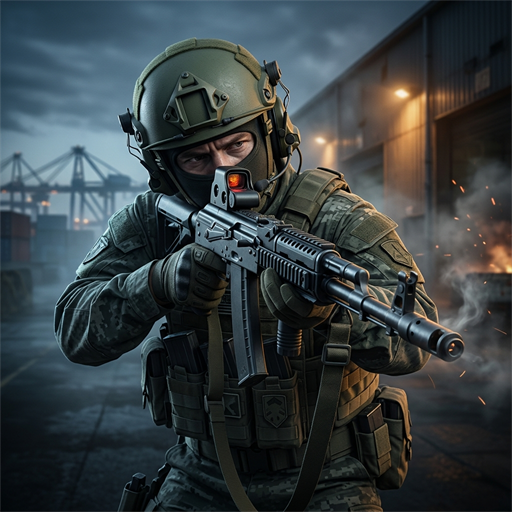

# TacticalFPS (Roblox Luau / Rojo)

Модульный многопользовательский FFA-шутер от первого лица (FPS) для **Roblox**, написанный на строгом **Luau** (`--!strict`) со структурой проекта под **Rojo**.



## Архитектура проекта (`src/`)

- **`src/server/`** — серверная логика:
  - `Bootstrap.server.luau` — инициализация `RemoteEvent` / `UnreliableRemoteEvent`, процедурных 3D-моделей оружия и сервисов
  - `CombatService.luau` — серверная валидация выстрелов, расчёт урона по хитбоксам (голова/торс/конечности), перезарядка, гранаты и подавление
  - `GameLoopService.luau` — цикл раундов, учёт фрагов и система голосования игроков за следующую карту
  - `MapService.luau` — генерация и переключение арен, настройка `Lighting` / атмосферы
  - `SpawnService.luau` — выбор точек спавна с учётом позиций противников
- **`src/client/`** — клиентские контроллеры:
  - `ClientMain.client.luau` — точка входа клиента и меню/настройки чувствительности
  - `WeaponController.luau` — режимы огня (`Auto` / `Semi`), тактическая и полная перезарядка, проверка магазина (удержание `R`), паттерны отдачи, трассеры и гранаты
  - `ViewmodelController.luau` — процедурный viewmodel, прицеливание (ADS), sway/bob и анимации
  - `MovementController.luau` — спринт, присед и наклоны (`Q` / `E`)
  - `HUDController.luau` — тактический HUD, прицел, маркеры попадания, kill-feed, табло и меню выбора карт/снаряжения
- **`src/shared/`** — общие модули:
  - `WeaponConfig.luau` — характеристики и модели оружия (`M4A1 SOPMOD`, `AK-74`, `MP5`, `M24`, `USP-45`)
  - `GrenadeConfig.luau` — физика броска и отскоков (`M67 Frag`, `M84 Flashbang`)
  - `MapConfig.luau` — пресеты 4 карт (`ProvingGround`, `WarehouseCQB`, `DesertOutpost`, `CargoDocks`)
  - `Ballistics.luau`, `Spring.luau`, `NetworkTypes.luau` — баллистика, пружинная физика и сетевые контракты

## Сборка через Rojo

```bash
rojo build default.project.json -o TacticalFPS.rbxl
# или live-синхронизация с Roblox Studio:
rojo serve default.project.json
```
